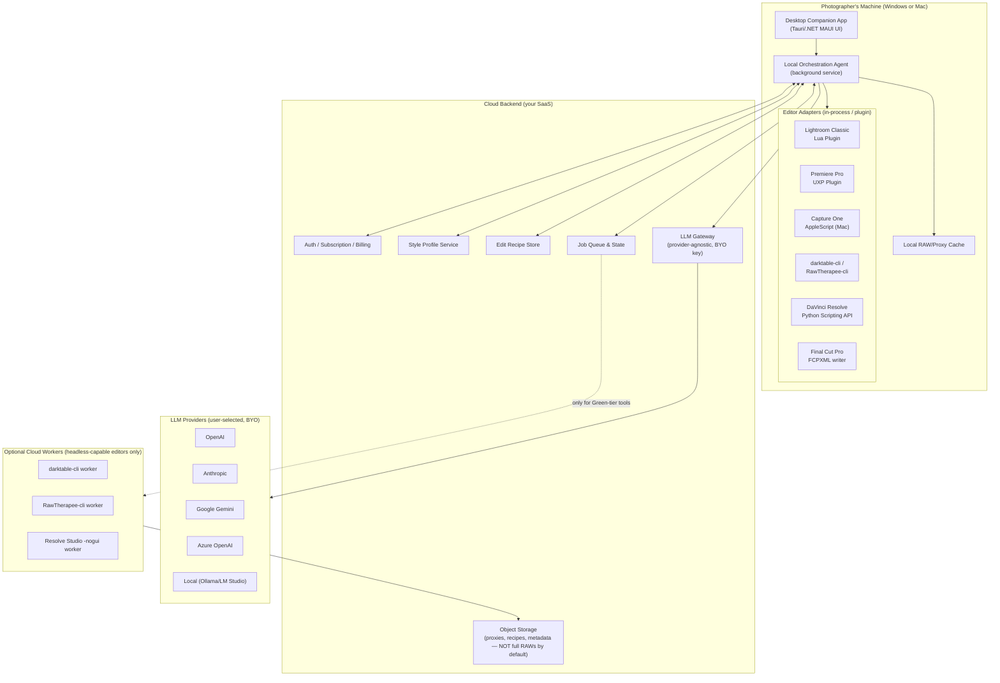
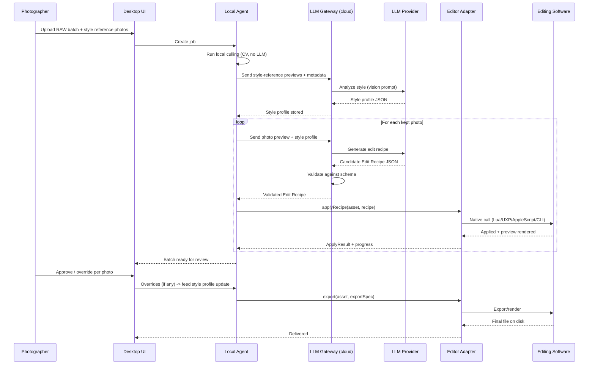

# Editing Automation Platform — Architecture & Delivery Plan

*AI-driven editing automation service for event photographers/videographers (weddings, birthdays, housewarmings, corporate events). Photographers upload RAW photos/video and sample finished work; the system learns their style and drives their own editing software (Adobe suite, Capture One, DxO, ON1, darktable, RawTherapee, Premiere, Resolve, Final Cut, CapCut, iMovie) to deliver edits fast. BYO editing software license + BYO LLM (any provider). Windows + macOS.*

**Status:** Draft v2 — architecture plan extended to a full-product plan (§7b–§7k added; §1–§6 corrected against primary-source verification).
**Last updated:** 2026-11-22
**Verification notes:** [docs/research/editor-integration-verification.md](docs/research/editor-integration-verification.md) · [docs/research/platform-and-market-verification.md](docs/research/platform-and-market-verification.md). Facts tagged **UNVERIFIED** below are tracked in §8 and the Phase 0 spikes.

---

## 0. Executive Summary & Go/No-Go

**Verdict: Conditional Go — but the product is NOT "instant cloud editing." It is a local-first AI co-pilot that drives software already installed and licensed on the photographer's own Windows/Mac machine, with a thin cloud layer for subscriptions, style profiles, and LLM orchestration.**

The single most important finding from the feasibility research changes the shape of the product:

> **Nearly every professional editor on the list (Lightroom Classic, Premiere Pro, Capture One, Final Cut Pro) can only be automated while running on the user's own machine, with the GUI process alive, under the user's own license — not as a headless server-side "render farm."** Adobe's General Terms §6.4 explicitly forbid using the desktop apps "as part of a hosted service... on behalf of any third party," and Premiere/Lightroom Classic plugins (UXP/Lua) execute *inside* the running application, not headlessly. Only **darktable, RawTherapee, and DaVinci Resolve (Studio)** have genuine server-side/headless automation paths. **CapCut and iMovie have no usable automation surface at all** and should be omitted from the roadmap (or handled only via risky/fragile GUI automation).

This means:
- **Architecture must be a local desktop "Agent"** installed on the photographer's machine that drives their already-licensed editors in-place, not a cloud service that ingests RAWs and edits them centrally for Adobe/Capture One/FCP workflows.
- **"Instant" delivery is realistic for darktable/RawTherapee/Resolve** (can run unattended, even on a cloud worker you operate) but for Adobe/Capture One/FCP, "instant" means *fast local automation while the photographer's machine is on*, not a 24/7 cloud pipeline.
- **BYO-LLM is unaffected** — this part of the plan is fully feasible: the LLM only needs to see preview-resolution images/metadata and emit a structured edit recipe; it never needs to touch the editing software directly.
- **This is still a strong business**, but it's an "AI co-pilot / smart automation layer for editors you already own" product, not a "send us your card, get back a finished album while you sleep" product — at least not for Adobe/Capture One/FCP. Set that expectation with photographers from day one.

**Recommended MVP pivot:** Start with the **Green-rated, headless-capable tools** (darktable, RawTherapee) to prove the LLM → edit-recipe → applied-result loop with true cloud/instant delivery, while *simultaneously* shipping the **Lightroom Classic Lua plugin** (Yellow) as the flagship "familiar tool" entry point, run locally. This gives you one honestly-instant cloud path and one high-demand local path for the initial release, rather than over-promising on Adobe cloud automation that requires an Enterprise/Firefly Services contract you likely don't have yet.

---

## 1. Feasibility & Integration Research

*(Researched with source citations via web search; items marked "needs verification" could not be confirmed from official docs. Research date: 2026-11-22.)*

| Tool | OS Support | Automation Surface | Headless? | File-driven possible? | ToS / Licensing | Stability Risk | Feasibility | Recommended Strategy |
|---|---|---|---|---|---|---|---|---|
| **Lightroom Classic** | Win + Mac | Lua plug-in SDK (`LrPhoto`, `LrDevelopController`, `LrCatalog`). Persistent background plugin + IPC via `LrSocket` (send/receive), `LrShell` (launch agent), `LrHttp` (client) is shown by open-source plugins; **official SDK reference is login-gated → `applyDevelopSettings`/`applyDevelopPresetAsync`, XMP read/write and `catalog:addPhoto` are UNVERIFIED** | **No** — runs inside the app; Develop module must be active for develop writes | Partial — XMP written by LrC, but externally-changed files are flagged and need user action | Adobe General Terms §6.4 / §6.6 (quoted in research file; "on behalf of any third party" wording is ambiguous → counsel); Developer Terms §5.1 approval/withdrawal, §8.2(D) no Adobe product names in plugin name | Medium — stable but no Auto Tone/WB API | 🟡 Yellow | Ship a Lua plugin that runs **locally**; agent↔plugin over `LrSocket`; Phase 0 spike on develop-write throughput |
| **Lightroom (cloud/CC)** | Cloud REST | Lightroom API (`xmp/develop`, renditions) + Photoshop API v2 `/v2/edit` | **Yes** (cloud) | Yes — XMP upload or structured slider edits | Firefly Lightroom API and Photoshop API v1 **reached EOL 2026-07-31 (already past)**. Lightroom API: "entitled partner" only, no documented sign-up. Photoshop API v2: **Adobe Enterprise / Firefly Services contract**; v2 develop-settings support unconfirmed | High — platform in flux | 🔴/🟡 Gated, no self-serve path | Do **not** plan on this. Open an Adobe sales/partner enquiry in parallel; revisit only if granted |
| **Capture One** | Win + Mac (**AppleScript is Mac-only; no official Windows automation found**) | AppleScript/JXA (2026 dictionary adds colour editor, people/subject/background masks, AI crop), `.costyle` styles | **No** — app must be running | Partial — `.costyle` has no public spec; files are cross-platform copyable | EULA **not retrieved** — read the installer EULA | Medium — sdef changes per version | 🟡 Yellow (Mac only) | AppleScript automation on Mac; Windows = manual style import only |
| **DxO PhotoLab** | Win + Mac | **None found** on vendor support sites; proprietary `.dop`/`.preset` | Not officially | Unverified/unreliable | Unknown | High | 🔴 Red | Omit from near-term roadmap |
| **ON1 Photo RAW** | Win + Mac | None found except a post-export script hook (not an editing API) | Unknown | Unknown | Needs verification | Unknown | 🔴 Red | Omit; re-check periodically |
| **darktable** (pin 5.6.x) | Win/Mac/Linux | `darktable-cli`, XMP sidecars, embedded Lua. `--style` needs `--core --configdir`; use `--apply-custom-presets 0` for parallel runs; library DB can take precedence over XMP | **Yes** — designed for background/server jobs | **Yes** — CLI reads XMP history stacks directly | GPL-3.0 — invoke as a **separate process**; do not link; bundling needs source-offer compliance (see §7k) | Low–medium — XMP blobs are module-version dependent | 🟢 Green | Generate XMP/styles, batch via CLI; pin version in compatibility matrix |
| **RawTherapee** (pin 5.13) | Win/Mac/Linux | `rawtherapee-cli`; PP3 profiles via `-p` (layerable), `-s/-S`, `-c` must be last | **Yes** — dedicated CLI binary | **Yes** — layered PP3 | GPL-3.0 (same policy as darktable) | Low — plain-text, incremental format | 🟢 Green | Generate PP3, batch via CLI |
| **Premiere Pro** | Win + Mac | UXP (`premierepro` module, **v27.0.0 / UXP 9.4**; `Application` class removed): sequence assembly, generic effect creation, AME export verified. **Lumetri-specific controls and ExtendScript status UNVERIFIED** | **No** — plugin runs inside the app | No for `.prproj` (undocumented) | Adobe terms as above; UXP direct distribution = no review, Marketplace = review | Medium — breaking changes per major | 🟡 Yellow | Local UXP plugin: assemble sequence, cuts, export via AME; colour via LUT/Lumetri if API confirmed |
| **DaVinci Resolve** | Win + Mac + Linux | Python/Lua scripting API (README verified): `-nogui`, `SetLUT` (needs pre-discovered LUT paths), `SetCDL`, `ApplyGradeFromDRX`, `ImportTimelineFromFile` (FCPXML/OTIO/AAF/EDL/DRT). Resolve 21 adds a Photo page | **Yes** (`-nogui`) | Partial — DRX stills, LUT/CDL, timeline import | **Free-edition external scripting UNVERIFIED** (README title says Studio, text says API is a common superset). Test on a clean install | Medium — docs ship only with the app | 🟢 Green (Studio) / 🟡 Free unknown | Gate behind "Requires Resolve Studio" until the clean-install test passes |
| **Final Cut Pro** | **Mac only** | FCPXML (published reference **1.10**; latest version unverified). Colour via `filter-video` (Color Board/Curves/Wheels/HueSat) and masks. Workflow Extensions are a UI integration, **not headless** | **No** — FCP must render | Yes for editorial structure and listed colour filters | Not retrieved — needs verification | Medium — FCPXML versioned | 🟡 Yellow | Generate FCPXML locally, import, user renders |
| **CapCut** | Win + Mac + mobile | **None official.** Unofficial `draft_content.json` tools exist, newer versions encrypt drafts | No | Unofficial only | **ToS explicitly bans** automated scripts interacting with the service | Very high | 🔴 Red | Omit from roadmap; do not build on this — real breach/ban risk |
| **iMovie** | Mac + iOS only | **None.** Only "Send to Final Cut Pro" | No | No | n/a | n/a | 🔴 Red | Omit; redirect iMovie users to the FCP adapter |

### Key non-technical risk
**Adobe's General Terms (§3.1, §6.2, §6.4, §6.6)** forbid using the desktop apps in a hosted/third-party service and require accessing the software only via Adobe-sanctioned interfaces. The compliant pattern is: **a plugin/agent running locally, under the photographer's own Adobe login, acting only on their own machine** — never a server farm running Lightroom Classic/Premiere on customers' behalf. This is a hard legal constraint, not a preference.

**Verified (see research file):** Adobe General Terms §6.4/§6.6 text; Adobe Developer Terms §5.1, §6.6, §8.2(D); Resolve scripting README; `darktable-cli` and RawTherapee CLI flags; Adobe cloud API EOL/gating.

### Gaps still needing direct verification before committing engineering time
- Lightroom Classic SDK reference (login-gated): develop-setting write API, XMP, `catalog:addPhoto`, throughput.
- Resolve **free edition** external scripting — test on a clean install.
- Capture One EULA (installer text) and DxO/ON1 EULAs.
- Latest FCPXML version; Premiere UXP Lumetri API; ExtendScript status in current Premiere.
- Whether Adobe's "on behalf of any third party" language prohibits a *local* agent that drives the user's own copy — counsel opinion required (see §8 Q8).

---

## 2. Core Architecture

### 2.1 System Diagram



**Why this shape:**
- **Adobe/Capture One/FCP path:** everything stays local. The Agent calls the in-process adapter; only *previews + metadata* (not full RAWs) are sent to the LLM for analysis and recipe generation; the recipe comes back and the local adapter applies it to the full-res file on disk.
- **Image data path (changed in v2):** by default the desktop Agent sends previews **directly to the user's chosen LLM provider with the user's own key and DPA**. The cloud "LLM Gateway" is then metadata-only (usage, prompts versions, recipe validation rules, price tables) or optional (bundled-credits tier). This keeps VivahLens from becoming a processor/sub-processor of children's image data in the default configuration. If the bundled-credits tier proxies images, VivahLens **is** a processor and the §3 processor package applies in full.
- **darktable/RawTherapee/Resolve-Studio path:** can genuinely run as a cloud worker fleet you operate, since these tools are either open-source (no ToS issue) or scriptable headlessly with a license the *user* supplies — be careful: running Resolve Studio on *your* infrastructure on behalf of many customers still needs you to check Blackmagic's EULA per seat; the safest version is user-provided compute too.
- **One architecture, two execution locations**, selected per adapter's feasibility rating — this is the core design decision the research forces.

### 2.2 Editor Adapter Abstraction

```ts
interface EditorAdapter {
  id: string;                     // "lightroom-classic", "darktable", ...
  capabilities: AdapterCapabilities;
  executionModel: "local-plugin" | "local-cli" | "cloud-headless";

  detect(): Promise<InstalledEditorInfo | null>;   // version, path, license status
  importAssets(assets: AssetRef[]): Promise<ImportResult>;
  applyRecipe(asset: AssetRef, recipe: EditRecipe): Promise<ApplyResult>;
  export(asset: AssetRef, exportSpec: ExportSpec): Promise<ExportResult>;
  getProgress(jobId: string): AsyncIterable<ProgressEvent>;
  cancel(jobId: string): Promise<void>;
  translateRecipe(recipe: EditRecipe): NativeEditPayload;  // recipe -> XMP/PP3/UXP calls/etc.
}

interface AdapterCapabilities {
  supportsPhoto: boolean;
  supportsVideo: boolean;
  headless: boolean;
  requiresGuiOpen: boolean;
  fileDrivenOnly: boolean;        // true for Capture One, Final Cut
  os: ("windows" | "macos")[];
  supportedRecipeFields: string[]; // subset of EditRecipe this adapter honors
}
```

A new editor (or a future proprietary `EditorEngine`) is added by implementing this interface — the orchestrator, LLM gateway, and UI never need to change.

### 2.3 Edit Recipe (tool-agnostic intermediate format)

See draft JSON Schema in §7.3. Each adapter implements a **partial** translator (`translateRecipe`) and reports which fields it supports via `supportedRecipeFields`, so the UI can warn "this editor doesn't support split-toning" before a job runs.

### 2.4 LLM Provider Abstraction

```ts
interface LLMProvider {
  id: string;                      // "openai", "anthropic", "google", "azure-openai", "local-ollama", "local-lmstudio"
  authMode: "api-key" | "oauth" | "local-endpoint";
  capabilities: {
    vision: boolean; toolUse: boolean; maxContextTokens: number;
    maxImagesPerRequest: number; maxImageBytes: number;
    imageTokenCost(widthPx: number, heightPx: number): number;
    structuredOutput: "json-schema-enforced" | "json-mode" | "prompt-only";
    reasoningControl: boolean;     // can cap thinking/reasoning tokens
    batchDiscount?: { discount: number; maxLatencyHours: number };
  };
  priceTable(): VersionedPriceTable;               // remote-configurable, with effective dates
  estimateCost(request: LLMRequest): CostEstimate; // includes reasoning tokens
  generate(request: LLMRequest): Promise<LLMResponse>;   // must validate response against EditRecipe schema
}
```

- **Per-provider request adapters**; model IDs and prices are remote-config, because providers change them on scheduled dates.
- **Verified cost (rough, 500 photos, ~1.5 MP preview + ~1k output tokens, see research file):** cheap tiers ≈ **$0.34–$1.48**, flagship tiers ≈ **$6.55–$27.8**. Reasoning tokens raise real cost. Default to cheap tiers, gate flagships behind a cost confirmation, and meter reasoning tokens. Offer an async **Economy (Batch)** mode separately — it conflicts with the <15 s/photo target. Azure prices/limits are UNVERIFIED.
- **BYO API key**, not BYO consumer chat subscription. ChatGPT Plus / Claude Pro accounts have **no supported programmatic API** — their web/app sessions cannot be scripted without violating ToS and are fragile (session tokens, CAPTCHAs). Clearly tell users: "bring an API key from OpenAI/Anthropic/Google/Azure, or run a local model" — not "bring your ChatGPT subscription."
- **Provider data policies (verified, see §3):** block/warn on **Gemini free-tier keys** (data used for training/human review); disclose OpenAI's retention exception for CSAM-flagged images and 30-day abuse logs, Anthropic 30-day deletion, Gemini default project logging, Azure abuse-monitoring sampling. Zero-data-retention is sales-gated at OpenAI/Anthropic.
- **Local models:** Ollama-native endpoint supports a `format` JSON Schema; the generic OpenAI-compatible path is **not** assumed to enforce schemas (UNVERIFIED) — always base64 images, validate, retry. LM Studio supports `json_schema` response_format. Weaker style matching quality — set expectations.
- All LLM output is **strictly validated against the Edit Recipe JSON Schema** before any adapter touches it; reject/retry (max 2) on violation; never let the LLM call editor APIs directly. Run a per-provider/model **structured-output conformance test** in CI (Phase 0 spike).

### 2.5 Orchestration Design
- **Deterministic pipeline with one bounded LLM call per stage**, not a free-roaming agentic loop touching the filesystem — this keeps behavior predictable and auditable, which photographers (and your support team) will need.
  1. Cull (vision model or classical CV — blur/eyes-closed/duplicate detection can be pure code, not LLM, to save cost).
  2. Style match (vision-LLM compares style-reference set to new batch, emits parameters).
  3. Recipe generation (schema-validated JSON).
  4. Adapter translation + apply (deterministic code, no LLM).
  5. Human review/approval checkpoint.
  6. Export/deliver.
- Human-in-the-loop checkpoint is **mandatory before final export** in v1 — this is both a trust-building feature and a liability mitigation (you are not shipping unreviewed client-facing deliverables).

### 2.6 Local-first vs Cloud Processing
- RAW/video files **never need to leave the photographer's machine** for the Adobe/Capture One/FCP path — only downscaled previews (long-edge ~2048px JPEG) and metadata go to the LLM Gateway. This also solves the biggest unstated scaling problem: multi-GB RAW/video uploads.
- For the Green-tier cloud-worker path (darktable/RawTherapee/Resolve), offer it as an **opt-in** "cloud render" mode for users who want true unattended/cloud delivery and are comfortable uploading originals (with clear storage/retention and deletion-on-delivery policies).

### 2.7 Desktop Stack Recommendation

| Option | Windows | macOS | Native automation access (AppleScript/COM/Win32) | Verdict |
|---|---|---|---|---|
| **Tauri (Rust + WebView)** | Yes | Yes | Good via Rust FFI/shell-out to native tools | **Recommended** — small footprint, strong for a UI + background-agent shape, easy to shell out to CLIs (darktable-cli, rawtherapee-cli, Resolve Python scripts) and to launch/script other apps via OS APIs |
| Electron | Yes | Yes | Good, but heavier (Chromium per instance), higher RAM for an always-on agent | Workable fallback if team is JS-only; avoid for an always-running background agent |
| .NET MAUI | Yes | Yes (via Mac Catalyst) | Native Win32/COM access is first-class on Windows; macOS story weaker | Good if team is C#-heavy and you lean on Lua/UXP/AppleScript sub-processes anyway |
| Native (Swift+WinUI, separate codebases) | Yes | Yes | Best native integration | Highest long-term quality, 2x the UI maintenance cost — revisit post-PMF |
| Flutter | Yes | Yes | Automation still goes through platform channels/shell-out regardless | No meaningful advantage here over Tauri for this use case |

**Recommendation: Tauri** for the shared UI shell + a small per-OS native helper (Rust) that shells out to AppleScript/osascript on Mac and COM/PowerShell on Windows where needed, plus subprocess calls to CLIs and Python/Lua interpreters for Resolve/darktable. Windows uses evergreen WebView2; macOS WKWebView follows the OS version, so set a minimum macOS version. The Electron/MAUI/Flutter/native comparison rows above are engineering judgement, not sourced facts.

### 2.8 Job Queue, Batch, Resumability
- Each asset is a unit of work with states: `queued → culled → style-matched → recipe-generated → applying → review → exported → delivered`.
- Persist job state locally (SQLite) so a batch of 1,500 wedding photos survives app restarts/crashes; sync summary state to cloud for cross-device status only.
- Offline mode: culling and local-adapter application can run without connectivity once a recipe/style profile is cached; LLM calls queue and retry when online.

---

## 2b. Style-Learning Engine

| Approach | What it does | Use when |
|---|---|---|
| **Vision-LLM descriptive analysis** | LLM looks at sample finished photos, emits a structured "style profile" (tone curve tendencies, WB bias, contrast, grain, crop ratio habits, skin-tone treatment) | Default for cold-start, no historical before/after pairs |
| **Before/after regression** | If the photographer has old Lightroom catalogs/XMPs for the *same* images as finished samples, diff the XMP develop settings directly — exact numeric ground truth, no LLM guessing | Best quality when available — prioritize building the XMP-diff ingester |
| **Embedding + nearest-neighbor** | Embed new RAW preview + style-reference images; retrieve nearest reference exemplar to pick per-scene style variant | Use for per-scene adaptation within one album (indoor vs outdoor, ceremony vs reception) |
| **LUT/profile extraction** | Derive a 3D LUT or color-matching transform from reference JPEGs vs their RAWs | Good supplement for video color-matching; feeds Resolve CDL/LUT application |
| **Fine-tuning** | Not recommended for v1 — expensive, slow iteration, and you lose per-customer BYO-LLM flexibility (fine-tunes are provider/model specific) | Defer to Phase 4+ if a specific photographer's volume justifies it |

- **Per-scene adaptation**: cluster the batch by lighting/scene signature (simple CV: histogram, color temperature estimate) before invoking style matching, so indoor reception photos don't get outdoor-ceremony settings.
- **Album-level consistency**: after per-image recipes are generated, run a consistency pass (compare recipe deltas across the album) and flag outliers for review rather than silently normalizing — photographers are sensitive to "why did this one look different."
- **Smart culling**: pure CV/classical ML — **do not burn LLM tokens on this**. Verified building blocks: LibRaw (embedded-preview extraction; choose CDDL or dynamically-linked LGPL), OpenCV (Apache-2.0; Laplacian-variance blur), YuNet (MIT) / MediaPipe (Apache-2.0) for faces/eyes, `imagehash` (BSD-2) for near-duplicates. Avoid dlib model weights until licensed. Note competitors treat culling as a commodity — it is table stakes, not the moat.
- **Video**: highlight/highlight-reel detection via audio energy + motion + face/smile detection; beat-sync cuts via audio onset detection; color matching via the LUT-extraction approach feeding Resolve's `SetCDL`/`SetLUT`.
- **Quality evaluation**: maintain a small "golden dataset" per style profile (10–20 photographer-approved pairs); score new output via perceptual similarity metrics (e.g., LPIPS-style) **plus** the explicit approval/correction signal from the review UI — every manual override is training signal that refines the style profile (simple weighted-average or few-shot example update, not full fine-tuning, for v1).

---

## 3. Security, Privacy & Compliance

- **Sensitive imagery**: event photos routinely include children — treat all data as containing minors by default. Build consent language into the photographer's client agreement template you provide, not just your own ToS.
- **Data minimization to LLMs**: send **preview-resolution images + EXIF-stripped-of-GPS metadata** by default; make "send full-resolution" an explicit opt-in per job, with a visible indicator of what's about to leave the device.
- **Regulatory**: GDPR/CCPA/India DPDP all apply depending on where the photographer and subjects are. Position VivahLens strictly as a **processor** and ship a **processor package**: DPA template, sub-processor list, processor ROPA, breach-notification runbook, deletion SLA, and a client-agreement consent clause for the photographer. **The official DPDP Act/Rules text could not be fetched during research** (MeitY/IndiaCode/PIB errors; only a PRS summary was used) — obtain it and confirm verifiable-parental-consent and processor-contract provisions with Indian counsel before launch. CCPA minors provisions are UNVERIFIED. Local-first remains the main compliance story ("clients' photos don't leave your computer except as previews sent to the AI you chose").
- **Credential storage**: LLM API keys and editor OAuth tokens → OS keychain via the Rust `keyring` crate (Windows Credential Manager / macOS Keychain); never plaintext config or unencrypted synced storage; avoid Tauri Stronghold for API keys. (`keyring` license UNVERIFIED — check.)
- **App distribution**: macOS needs Apple Developer ID ($99/yr) + notarization credentials in CI. Windows: EV certs no longer give instant SmartScreen reputation and Smart App Control blocks unsigned binaries, so signing is mandatory but not sufficient. **Azure Artifact Signing public-trust is limited to listed countries (not India) and individuals only in US/Canada** — pick a signing entity/CA strategy in Phase 0. Auto-update via Tauri's signed updater; **updater private-key custody and offline backup are critical** (loss strands all installs). Telemetry strictly opt-in, scrubbed of customer content.

---

## 4. Product & UX

- **Personas**: solo wedding photographer (volume, speed-to-delivery pressure), small studio with 2–3 editors (consistency across editors is the pain point), high-volume event photographer (housewarmings/corporate — fast turnaround, lower per-photo attention).
- **MVP scope**: single-editor photo workflow (Lightroom Classic **or** darktable/RawTherapee for the honest-cloud path) + culling + style-match + review + export. No video in MVP.
- **Onboarding**: (1) detect installed editors on this machine → (2) connect LLM provider (paste API key or point to local endpoint, show a cost estimate) → (3) upload 10–30 style-reference finished photos → (4) run first batch of 50 photos as a guided trial.
- **Review/approve UI**: side-by-side before/after, batch-grid with per-photo thumbnails and a single-click "approve all" plus per-photo override sliders (map directly to Edit Recipe fields so corrections are structured, not free text) — every override feeds back into the style profile (§2b).
- **"Instant" — set a real target**: for the local path, target **first preview back in <15s per photo**, full batch of 500 photos locally applied in **<10 minutes** (dominated by the adapter/app speed, not your code); for the cloud-worker path (darktable/RawTherapee), target **<2 minutes for a 500-photo batch** end-to-end given you control the compute. Always show a live progress stream, never a spinner with no ETA.

---

## 5. Business Model & Pricing

- **Subscription tiers (revised against verified competitor pricing):** competitors sell **flat, unlimited-photo plans** ($7.50–$60/mo; Aftershoot from $8/mo annual, Narrative $10–$60, FilterPixel $7.50–$32.50; Imagen $129–$165/mo or $0.05/photo + $7/mo — retrieved dates in research file). Do **not** cap Starter by photos/month. Proposed: **Starter** (1 editor adapter, culling + styling, BYO key), **Pro** (all photo adapters, video, style-profile sharing), **Studio** (team seats, client galleries/delivery, API). Fix prices after Phase 1 willingness-to-pay interviews; anchor Starter near $15–25/mo.
- **LLM cost ownership**: BYO key = photographer pays provider directly (≈ $0.3–1.5 per 500 photos on cheap tiers); you charge only for software. Optional **bundled-credits tier** for non-technical users — meter and mark up; this makes you an image processor (§3).
- **Billing / merchant of record:** Stripe Managed Payments excludes India-based sellers; **Paddle or Lemon Squeezy** are the verifiable MoR options (Lemon Squeezy 5% + 50¢ ≈ 10% drag on a $10 plan). Paddle licence-key support, Lemon Squeezy seller eligibility/post-acquisition status are UNVERIFIED. License enforcement: Lemon Squeezy keys + activation limits, or in-house signed offline-verifiable tokens (see §7d).
- **Unit economics**: costs are cloud workers (if offered), small object storage, billing fees (~10%), and support (high — editor-version fragility).
- **Competitors**: Imagen AI, Aftershoot, Narrative, FilterPixel. **Local-first processing and personal style learning are already claimed by Aftershoot/Narrative/FilterPixel — not sufficient differentiators.** Differentiate on: (1) **editor-agnostic adapters** incl. video and darktable/RawTherapee/Resolve, (2) **BYO/local LLM with transparent cost and data path**, (3) structured, editable **Edit Recipe** output (the photographer sees and tunes parameters, not a black box), (4) event-album consistency tooling. Adobe shipping native AI remains a platform risk.
- **Platform risk**: Adobe/Blackmagic/Apple can change APIs or ship competing native AI at any time — mitigate with the Edit Recipe abstraction and by not over-indexing on any one adapter.

---

## 6. Roadmap & Delivery Plan

### Phase 0 — Spikes (2–4 weeks, 1–2 engineers)
1. Download and read the actual Lightroom Classic SDK PDF; confirm `applyDevelopSettings` batch behavior and whether a plugin can run as a passive background listener.
2. Prototype: LLM generates an XMP-equivalent recipe → apply via darktable-cli to 100 RAWs → photographer rates acceptance. **Success criterion: ≥70% "no manual correction needed."**
3. Confirm DaVinci Resolve Free vs Studio scripting restriction directly with Blackmagic docs/support.
4. Confirm Capture One Windows scripting story (research found none official) and read the installer EULA.
5. **(new)** Resolve clean-install test: does the free edition accept external scripting?
6. **(new)** Signing-entity/certificate path (Azure Artifact Signing excludes India) + macOS Developer ID.
7. **(new)** Merchant of record + license enforcement decision (Paddle vs Lemon Squeezy vs in-house tokens).
8. **(new)** Legal: official DPDP Act/Rules review, Adobe "third party" counsel opinion, GPL bundling policy.
9. **(new)** Structured-output conformance test per provider/model (OpenAI, Anthropic, Gemini, Ollama, LM Studio) against the EditRecipe schema.
10. **(new)** LrC develop-write throughput spike over `LrSocket` (needs the SDK download).

**Kill criterion:** if LLM-generated recipes need manual correction >50% of the time even after prompt/schema iteration, the style-matching approach needs fundamental rework before any further investment.

### Phase 1 — MVP (8–12 weeks)
- **Local** darktable + RawTherapee adapters (user-installed, invoked as separate processes — no GPL bundling) and the Lightroom Classic Lua plugin. Opt-in **cloud render** for Green-tier tools is a stretch goal, not an MVP gate (it requires uploading originals).
- Ingest, culling, style-match, recipe gen, review UI, export (§7b), accounts/licensing (§7d), installers + updater (§3), diagnostics (§7.6).
- Team: 2 backend/orchestration, 1 desktop (Tauri), 1 ML/prompt engineer, 1 designer (part-time).

**Exit criteria:** a real photographer runs a full wedding batch end-to-end and approves ≥80% of photos with zero or trivial correction; the §7j launch-readiness checklist is green for the MVP scope.

### Phase 2 — Delivery, Teams & Premiere Pro + Video (10 weeks)
- Client delivery & galleries, team seats / shared style profiles (§7e, §7d).
- Premiere UXP plugin for sequence assembly/export; highlight detection; beat-synced rough cut (§7f).
- **Risk:** UXP breaking changes across Premiere versions — pin tested versions, add a compatibility check at startup.
- **Exit:** a studio of 3 editors shares one style profile; a 5-minute highlight reel is rough-cut from a real event.

### Phase 3 — Open-source parity + hardening (6 weeks)
- Production reliability for darktable/RawTherapee (XMP module-version handling, batch-concurrency limits), optional cloud-render mode, performance/SLO tuning (§7h), accessibility/i18n pass (§7i).

### Phase 4 — Resolve, FCP, Capture One, ON1/DxO re-check (10–14 weeks)
- Resolve grading adapter (Studio-gated unless Phase 0 test passes); FCPXML generation for FCP; Capture One AppleScript adapter (Mac only); re-verify ON1/DxO.

### Phase 5 — CapCut/iMovie decision point + optional proprietary engine
- Do not build CapCut/iMovie automation on unofficial/ToS-violating tooling. Evaluate a proprietary lightweight editing engine (FFmpeg/OpenColorIO) as a fallback target for users without a supported pro tool.

### Risk Register (top items)

| Risk | Mitigation |
|---|---|
| Adobe ToS violation via hosted automation | Strict local-only execution model for Adobe adapters; legal review of plugin distribution before launch |
| LLM output breaks editor (invalid XMP/PP3/UXP call) | Strict schema validation + adapter-side dry-run/sandbox apply before touching the user's catalog |
| Editor version updates break adapters (UXP 27.0-style breaking changes) | Adapter version pinning + compatibility matrix + fast-follow CI against new editor betas |
| CapCut/iMovie pressure from users despite Red rating | Set expectations explicitly in marketing; do not quietly build on unofficial tooling |
| Resolve Free-edition scripting restriction confirmed true | Clearly gate the Resolve adapter behind "requires DaVinci Resolve Studio" in the UI |
| Adobe interprets "on behalf of any third party" to cover a local agent | Counsel opinion in Phase 0; fallback = ship darktable/RawTherapee-first and treat Adobe adapters as user-initiated plugins only |
| Competitors already claim local-first + personal style | Lead with editor-agnosticism, BYO/local LLM, editable recipes (§5) |
| Updater key or signing certificate lost/revoked | Offline key backup, documented rotation, second CA path |
| Gemini free-tier / provider retention exposes minors' images | Block free-tier keys, disclose provider policies in onboarding, default previews-only |
| GPL obligations triggered by bundling darktable/RawTherapee | Invoke user-installed binaries as separate processes; NOTICE file + CI license scan (§7k) |

---

## 7. Technical Deliverables

### 7.1 Tech Stack

| Layer | Choice | Why |
|---|---|---|
| Desktop shell | Tauri (Rust + web UI) | Small footprint, strong shell-out/FFI for native automation, cross-platform |
| Background agent | Rust service (part of Tauri) or a separate OS service for always-on behavior | Low resource use for an always-running component |
| Cloud backend | Node.js/TypeScript or Go, Postgres, Redis (job queue) | Standard, fast to hire for |
| LLM Gateway | Thin provider-agnostic proxy (LiteLLM-style) | Normalizes OpenAI/Anthropic/Google/Azure/local calls behind one interface |
| Object storage | S3-compatible | Previews, recipes, exports only — not full RAWs by default |
| Local DB | SQLite | Per-machine job/state persistence |

### 7.2 Repository Structure (suggested)
```
/apps/desktop-client        (Tauri UI + agent)
/apps/cloud-api             (subscription, profiles, job metadata)
/apps/llm-gateway
/packages/edit-recipe-schema  (shared JSON Schema + codegen'd types)
/packages/editor-adapters
    /lightroom-classic
    /premiere-pro
    /capture-one
    /darktable
    /rawtherapee
    /davinci-resolve
    /final-cut-pro
/packages/style-engine
```

### 7.3 Draft Edit Recipe JSON Schema
```json
{
  "$schema": "https://json-schema.org/draft/2020-12/schema",
  "title": "EditRecipe",
  "type": "object",
  "required": ["version", "assetType", "adjustments"],
  "properties": {
    "version": { "type": "string", "const": "1.0" },
    "assetType": { "enum": ["photo", "video"] },
    "sourceStyleProfileId": { "type": "string" },
    "adjustments": {
      "type": "object",
      "properties": {
        "exposure":   { "type": "number", "minimum": -5, "maximum": 5 },
        "contrast":   { "type": "number", "minimum": -100, "maximum": 100 },
        "whiteBalance": {
          "type": "object",
          "properties": {
            "tempK": { "type": "number", "minimum": 2000, "maximum": 50000 },
            "tint":  { "type": "number", "minimum": -150, "maximum": 150 }
          }
        },
        "highlights": { "type": "number", "minimum": -100, "maximum": 100 },
        "shadows":    { "type": "number", "minimum": -100, "maximum": 100 },
        "whites":     { "type": "number", "minimum": -100, "maximum": 100 },
        "blacks":     { "type": "number", "minimum": -100, "maximum": 100 },
        "vibrance":   { "type": "number", "minimum": -100, "maximum": 100 },
        "saturation": { "type": "number", "minimum": -100, "maximum": 100 },
        "toneCurve": {
          "type": "array",
          "items": {
            "type": "object",
            "properties": {
              "input":  { "type": "number", "minimum": 0, "maximum": 255 },
              "output": { "type": "number", "minimum": 0, "maximum": 255 }
            }
          }
        },
        "hsl": {
          "type": "object",
          "description": "Per-color-channel hue/saturation/luminance adjustments",
          "additionalProperties": {
            "type": "object",
            "properties": {
              "hue": { "type": "number", "minimum": -100, "maximum": 100 },
              "saturation": { "type": "number", "minimum": -100, "maximum": 100 },
              "luminance": { "type": "number", "minimum": -100, "maximum": 100 }
            }
          }
        },
        "splitToning": {
          "type": "object",
          "properties": {
            "highlightHue": { "type": "number", "minimum": 0, "maximum": 360 },
            "highlightSaturation": { "type": "number", "minimum": 0, "maximum": 100 },
            "shadowHue": { "type": "number", "minimum": 0, "maximum": 360 },
            "shadowSaturation": { "type": "number", "minimum": 0, "maximum": 100 },
            "balance": { "type": "number", "minimum": -100, "maximum": 100 }
          }
        },
        "crop": {
          "type": "object",
          "properties": {
            "aspectRatio": { "type": "string" },
            "x": { "type": "number" }, "y": { "type": "number" },
            "width": { "type": "number" }, "height": { "type": "number" },
            "rotationDeg": { "type": "number" }
          }
        },
        "noiseReduction": {
          "type": "object",
          "properties": {
            "luminance": { "type": "number", "minimum": 0, "maximum": 100 },
            "color": { "type": "number", "minimum": 0, "maximum": 100 }
          }
        },
        "sharpening": {
          "type": "object",
          "properties": {
            "amount": { "type": "number", "minimum": 0, "maximum": 150 },
            "radius": { "type": "number", "minimum": 0.5, "maximum": 3 }
          }
        },
        "lutRef": { "type": "string", "description": "Reference to a generated/extracted 3D LUT file" },
        "videoEdits": {
          "type": "object",
          "properties": {
            "cuts": {
              "type": "array",
              "items": {
                "type": "object",
                "properties": {
                  "clipId": { "type": "string" },
                  "inSec": { "type": "number" },
                  "outSec": { "type": "number" },
                  "transitionIn": { "enum": ["none", "cut", "crossfade", "dip-to-black"] }
                }
              }
            },
            "colorGrade": { "$ref": "#/properties/adjustments/properties/lutRef" },
            "cdl": {
              "type": "object",
              "properties": {
                "slope": { "type": "array", "items": { "type": "number" }, "minItems": 3, "maxItems": 3 },
                "offset": { "type": "array", "items": { "type": "number" }, "minItems": 3, "maxItems": 3 },
                "power": { "type": "array", "items": { "type": "number" }, "minItems": 3, "maxItems": 3 },
                "saturation": { "type": "number" }
              }
            }
          }
        }
      }
    },
    "confidence": { "type": "number", "minimum": 0, "maximum": 1 },
    "notes": { "type": "string" }
  }
}
```

### 7.4 Sequence Diagram — Upload → Style Learning → Edit → Review → Export



### 7.5 Testing Strategy
- **Adapter contract tests**: a shared test suite every adapter must pass (apply known recipe → assert resulting file/metadata matches expected within tolerance), run against pinned editor versions in CI where headless/CLI tools allow it (darktable, RawTherapee, Resolve); GUI-bound adapters (LrC, Premiere, Capture One) need a scheduled manual/VM-based regression pass per editor update.
- **Golden-image tests**: a fixed set of RAW + style-reference pairs with known-good expected recipes; flag any drift when prompts/models change.
- **LLM eval harness**: track recipe-schema-validity rate, "no correction needed" acceptance rate, and per-field deviation from golden recipes across model/provider changes — this is your core quality metric over time.
- **Cross-OS CI**: Windows + macOS runners for the Tauri shell and Rust agent; separate manual/VM lanes for Mac-only (Capture One AppleScript, FCP) and Windows-only edge cases.

### 7.6 Observability & Rollout
- Per-job structured logs (job id, adapter, recipe hash, LLM provider/model, latency, outcome) — scrub image content, keep only metadata.
- Staged rollout per adapter (beta flag), since each one has independent version-fragility risk.
- In-app diagnostics bundle (sanitized) for support to debug "my Lightroom plugin stopped applying edits" tickets quickly.

---

## 7b. Ingest, Asset & Data Model *(new in v2)*

**Ingest pipeline (per job):** select folder/card → hash (xxHash) + dedupe against the local library → read EXIF/XMP via LibRaw/ExifTool → extract the embedded JPEG preview (fallback: decode RAW at half-size) → write 2048px long-edge preview + 512px thumbnail into the cache → group by capture time/scene signature → enqueue. Originals are **never moved or modified**; edits are written as sidecars/catalog operations by the adapter. Supported inputs: major RAW families (CR2/CR3, NEF, ARW, RAF, ORF, DNG), JPEG/HEIC, and video (MP4/MOV/MXF/BRAW via editor, proxies via FFmpeg).

**Local SQLite schema (core tables):**

| Table | Key columns |
|---|---|
| `asset` | id, path, content_hash, kind (photo/video), capture_time, camera, lens, iso, scene_cluster_id, preview_path, thumb_path |
| `job` | id, name, event_type, adapter_id, style_profile_id, llm_provider, model, state, created_at, cost_estimate, cost_actual |
| `job_item` | job_id, asset_id, state (see §2.8), cull_score, cull_reasons, recipe_id, error_code, attempts, updated_at |
| `recipe` | id, asset_id, schema_version, json, source (llm/override/profile), confidence, hash |
| `style_profile` | id, name, version, descriptor_json, exemplar_ids, golden_set_id, created_at |
| `override` | id, recipe_id, field_path, old_value, new_value, user_id, created_at (feeds §2b) |
| `export_spec` / `delivery` | format, size, color space, sharpening, watermark, destination, gallery_id, status |
| `audit_event` | ts, actor, action, job_id, metadata (no image content) |

**Cloud (Postgres) schema:** `account`, `organization`, `seat`, `subscription`, `license_activation`, `style_profile_sync` (encrypted descriptors, no images), `usage_event` (counts, tokens, cost — no content), `gallery`, `gallery_asset`, `delivery_link`, `audit_event`, `price_table`, `model_catalog`.

**Schema migration policy:** forward-only versioned migrations on both stores; `EditRecipe.version` is bumped for breaking changes and the recipe store keeps a converter chain so old recipes remain re-appliable.

## 7c. Local Agent ↔ Editor IPC & Cloud API Contract *(new in v2)*

**Agent ↔ UI:** Tauri commands/events; the Agent owns the job state machine and is the single writer to SQLite.

**Agent ↔ adapters:**
- *CLI adapters* (darktable, RawTherapee, FFmpeg): subprocess with a per-job working dir, timeout, concurrency cap = physical cores − 1, stdout/stderr captured to structured logs.
- *Lightroom Classic plugin:* plugin starts a background task, opens an `LrSocket` to the Agent on a random loopback port, authenticates with a per-session token handed over in a launch file under the user profile (not the command line), and receives `applyRecipe` messages; replies with `ApplyResult` + progress. If LrC is closed the adapter reports `editor-not-running` and offers a launch action. Fallback if sockets prove unreliable: file-drop queue polled by the plugin.
- *Premiere UXP:* equivalent loopback WebSocket from the UXP panel to the Agent.
- *Capture One:* `osascript` per batch with a cap on call rate; *Resolve:* Python subprocess (`-nogui` where permitted); *FCP:* FCPXML file generation + import instruction.
- All loopback listeners bind to 127.0.0.1 only, require the session token, and reject unknown origins.

**Cloud REST API (v1) — resources:** `POST /auth/device` (device-code login), `GET/PUT /style-profiles`, `POST /usage-events`, `GET /entitlements` (signed), `GET /model-catalog` and `/price-table` (signed remote config), `POST /galleries`, `POST /galleries/{id}/assets` (pre-signed upload), `POST /delivery-links`, `GET /updates/manifest`, `POST /support/diagnostics` (user-initiated). OpenAPI spec lives in `/apps/cloud-api`; all write endpoints are idempotent (`Idempotency-Key`). Rate limits per account; 4xx/5xx error envelope with stable `error_code`.

## 7d. Accounts, Licensing, Billing & Teams *(new in v2)*

- **Identity:** email/password + OAuth (Google/Apple), TOTP 2FA, device-code login for the desktop app. Sessions are refresh tokens in the OS keychain.
- **Entitlements:** the server issues a **signed entitlement token** (plan, seats, adapter flags, expiry ≤ 7 days). The Agent verifies the signature offline and works fully offline within the grace window (14 days), then degrades to read-only/export-only — never destroys user work.
- **Seats & devices:** per-seat activation with a device cap (default 2); self-service deactivate.
- **Billing:** merchant-of-record (Paddle or Lemon Squeezy, decided in Phase 0) handles tax, invoices, refunds, dunning; webhooks drive entitlements. Trial: 14 days / one guided 50-photo batch, no card.
- **Teams (Studio tier):** org with admin/editor/viewer roles, shared style profiles with versioning and rollback, audit log, per-seat usage.
- **Data subject tools:** export and delete account in-app; deletion SLA published (§7k).

## 7e. Delivery, Galleries & Client Experience *(new in v2)*

- **Export presets:** web (sRGB, 2048px), print (AdobeRGB/ProPhoto, full-res, TIFF/JPEG), social, album-design; optional watermark and IPTC/copyright injection; GPS stripping default-on.
- **Delivery:** local folder, SFTP, or (Studio tier) hosted client gallery: pre-signed uploads, expiring password-protected links, favorites/selection by the client, download-all ZIP, retention-and-delete-on-expiry. Gallery data is the only point where originals/finals touch our cloud, and is opt-in and covered by the §7k processor package.
- **Client proofing loop:** client picks favorites → photographer-side "retouch these" queue → re-run adapter on the selected subset.
- **Notifications:** batch complete / needs review / failure, via desktop notification and email.

## 7f. Video Pipeline Detail *(new in v2)*

Scope is explicitly **assistive rough-cut + grade**, not auto-final edit.
1. Proxy generation with FFmpeg (H.264 720p) and audio extraction.
2. Analysis (local, no LLM): shot-boundary detection, audio energy/speech/music segmentation, motion score, face/smile detection, blur/shake detection.
3. Highlight selection by weighted score with a target duration; beat/onset detection (e.g., librosa-class algorithms) for music-synced cuts.
4. LLM stage (previews only): captions/scene labels over sampled keyframes, ordering for ceremony → reception narrative, producing `videoEdits` in the EditRecipe.
5. Adapter apply: Premiere UXP (sequence + AME export), Resolve (timeline import + LUT/CDL), FCP (FCPXML).
6. Review UI with timeline view; one-click swap of any suggested clip.
Colour matching uses LUT/CDL extraction (§2b). Music licensing is the photographer's responsibility; the app never bundles music.

## 7g. Error Handling, Recovery & Support *(new in v2)*

- **Error taxonomy** with stable codes: `LLM_SCHEMA_INVALID`, `LLM_RATE_LIMIT`, `LLM_AUTH`, `ADAPTER_EDITOR_NOT_RUNNING`, `ADAPTER_VERSION_UNSUPPORTED`, `ADAPTER_APPLY_FAILED`, `ASSET_UNREADABLE`, `DISK_FULL`, `ENTITLEMENT_EXPIRED`. Each maps to a user-facing message and a one-click remedy.
- **Retries:** exponential backoff with jitter on transient LLM/network errors; max 2 schema-repair retries; per-item failure never fails the batch — failed items go to a "needs attention" lane.
- **Safety:** adapters write to a **copy/sidecar first** and verify before committing; every apply is reversible via the job's undo log; originals are read-only.
- **Budget guardrails:** per-job spend cap with a confirmation when the estimate (incl. reasoning tokens) exceeds it.
- **Support:** in-app sanitized diagnostics bundle (§7.6), compatibility-matrix page, public status page, knowledge base + community channel, severity-based SLA for paid tiers. An "editor version unsupported" banner links directly to the matrix.

## 7h. Non-Functional Requirements & SLOs *(new in v2)*

| Area | Target |
|---|---|
| First preview per photo (local path) | < 15 s p90 (cheap-tier model) |
| 500-photo local batch apply | < 10 min p90, excluding LLM latency spikes |
| Cloud-render 500-photo batch (opt-in, Green tier) | < 2 min p90 end-to-end |
| Agent idle footprint | < 150 MB RAM, < 1% CPU |
| App start to ready | < 3 s |
| Crash-free sessions | ≥ 99.5% |
| Resumability | batch of 1,500 survives kill -9 with zero lost completed items |
| Cloud API availability | 99.9% monthly (entitlements degrade gracefully offline) |
| Minimum hardware | 16 GB RAM, SSD, 4 cores; Windows 10 22H2+/11, macOS (minimum set per WKWebView requirement) |

## 7i. Accessibility, Localization & UX Quality *(new in v2)*

- WCAG 2.2 AA for the desktop UI: full keyboard navigation of the review grid, screen-reader labels, high-contrast and reduced-motion modes, colour-managed previews (display profile aware) so the photographer judges tone correctly.
- i18n from day one (ICU message format); launch locales: English, Hindi; next: Spanish, German, Portuguese. Locale-aware currency/date and RTL-safe layout.
- Keyboard-first review shortcuts (approve, reject, compare, next scene) — expected by high-volume event shooters.
- UX validation: 5 moderated usability sessions per release milestone; task success ≥ 90% on onboarding.

## 7j. Release Engineering & Launch-Readiness Checklist *(new in v2)*

**Release:** trunk-based, signed installers (MSI/EXE; DMG), channels (alpha/beta/stable) with staged rollout and one-click rollback via the updater manifest; per-adapter feature flags; release notes generated from changelog; compatibility matrix regenerated per release.

**Launch gate (all must be green for MVP):**
- [ ] ≥ 80% acceptance in the Phase 1 exit test; schema-valid rate ≥ 99% after retries
- [ ] Signed + notarized installers; updater tested including rollback
- [ ] Entitlement + billing flow tested end-to-end (purchase, renew, cancel, refund, offline grace)
- [ ] Processor package, privacy policy, ToS, client-agreement template reviewed by counsel
- [ ] Threat model (§7k) mitigations implemented; dependency/licence scan clean
- [ ] Diagnostics, status page, support inbox and KB staffed
- [ ] Telemetry opt-in verified to carry no image content
- [ ] Beta with ≥ 10 photographers, ≥ 3 full real events processed
- [ ] Pricing page, onboarding emails, docs and demo video ready

**Success metrics:** activation (first batch finished within 24 h), recipe acceptance rate, time-to-delivery vs the photographer's prior baseline, weekly active batches, 30/90-day retention, support tickets per 100 batches, gross margin after MoR fees.

## 7k. Threat Model, Compliance Operations & Open-Source Licensing *(new in v2)*

**Threat model (STRIDE summary):**

| Threat | Mitigation |
|---|---|
| Local loopback IPC hijack by another process | 127.0.0.1 bind, per-session token, origin check, token file ACL'd to the user |
| Prompt injection via image text/EXIF causing unsafe recipe | LLM output is data only; strict schema + value clamping; no tool/filesystem access for LLM |
| Malicious RAW/video exploiting decoders | Decode in a separate low-privilege process; keep LibRaw/FFmpeg patched; fuzz inputs in CI |
| API-key theft | OS keychain only; keys never sent to our cloud in BYO mode; redact from logs |
| Update-channel compromise | Signed updater manifests, offline key custody, key rotation procedure |
| License tampering / sharing | Signed entitlements, device cap, server-side revocation; accept some offline-piracy loss |
| Cloud data breach (galleries) | Encryption at rest/in transit, per-tenant prefixes, short-lived pre-signed URLs, retention auto-delete, access logging |
| Image leakage to LLM beyond user intent | Preview-only default, GPS-stripped EXIF, visible "what leaves your device" indicator, per-job opt-in for full-res |

**Compliance operations:** processor package (§3) maintained; sub-processor list published with change notice; breach-response runbook (72-hour GDPR clock); deletion SLA (e.g., 30 days, with provider-side retention disclosed); annual security review; SOC 2 readiness assessment before enterprise/studio sales.

**Open-source licensing policy:** no GPL code linked into the closed-source app; darktable/RawTherapee are **user-installed and invoked as separate processes** (v1 does not bundle them; any later bundling requires a source offer and counsel sign-off); LibRaw via CDDL or dynamic LGPL; maintain a `NOTICE` file and run an automated licence scan (e.g., cargo-deny, license-checker) in CI. ExifTool, rawpy, dcraw, dlib weights and `keyring` licences are UNVERIFIED — read before shipping.

---

## 8. Open Questions (ranked by impact)

1. **Is the local-only execution model (vs. a cloud render farm) acceptable to your target customers and investors?** This is the single biggest pivot from the original "instant cloud editing" vision — resolve by validating with 5–10 target photographers before further build-out.
2. **Will you pursue an Adobe Enterprise/Firefly Services contract** to unlock server-side Photoshop API editing? Verified: Lightroom API and Photoshop API v1 are already EOL (2026-07-31); only Photoshop API v2 remains, Enterprise-gated, with no self-serve path. Resolve by an Adobe sales/partner enquiry.
3. **Is DaVinci Resolve's free edition scriptable externally?** UNVERIFIED — test on a clean install; until then treat Resolve as Studio-only.
4. **Capture One on Windows:** no official automation found; treat as Mac-only unless Capture One support says otherwise. Still read the EULA.
5. **How much manual correction will photographers actually tolerate** before the "AI-edited" value proposition breaks down? Resolve via the Phase 0 acceptance-rate spike.
6. **Do you offer a bundled-LLM-credits tier, or BYO-key only at launch?** Affects onboarding friction vs. margin exposure — decide based on early user interviews (technical vs. non-technical photographers).
7. **Legal: does your subscription ToS and the photographer's client agreements adequately cover AI processing of event imagery containing minors?** Resolve with counsel; include the official DPDP Act/Rules text (not yet retrieved).
8. **Does Adobe's §6.4 "on behalf of any third party" language prohibit a local agent that drives the user's own Lightroom/Premiere?** Counsel opinion before any Adobe-facing code ships.
9. **Which legal entity and country will sell the product?** Drives signing options (Artifact Signing excludes India), MoR eligibility and tax.
10. **Pricing:** what will photographers pay vs. flat competitor plans ($8–$60/mo)? Validate in interviews.

---

## First 30 Days — Action Checklist

- [ ] Download and read the official Lightroom Classic Lua SDK docs (login-gated; needed for the UNVERIFIED API items).
- [ ] Clean-install test of Resolve Free external scripting; read Capture One/DxO/ON1 EULAs.
- [ ] Counsel review: Adobe General Terms §6.4/§6.6 + Developer Terms, official DPDP text, GPL bundling policy, client-agreement AI/minors clause.
- [ ] Choose legal entity, signing path (CA/Developer ID) and merchant of record; set up updater key custody.
- [ ] Build the Phase 0 spike: LLM → Edit Recipe → darktable-cli apply → photographer acceptance test on a real RAW set (target ≥70% acceptance).
- [ ] Draft the Edit Recipe JSON Schema into a shared package with TypeScript codegen and the per-provider structured-output conformance test.
- [ ] Stand up the LLM Gateway skeleton with ≥2 providers (one API-based, one local via Ollama) plus the versioned price table.
- [ ] Interview 5–10 target photographers on local execution, turnaround expectations and pricing.
- [ ] Scaffold the repo structure in §7.2 and lock the desktop stack (recommendation: Tauri).
- [ ] Define the SQLite schema (§7b) and the IPC contract (§7c) as code.

---

## Implementation Status *(updated 2026-11-22, 6th pass)*

TypeScript monorepo of 13 packages (`npm run ci` = build + tests + licence gate; **Node ≥ 22.13**). **1,118 tests in 93 files: 1,108 pass, 10 skipped by design** (adapter export contracts for adapters that only write edits, and two platform-specific cases). Runtime dependencies are `jpeg-js` and `zod` only. How to run it: [README.md](README.md). Where a row says *unverified*, the code exists and is tested against fakes or from sources, but has **never run against the real thing** (see "What has never been run" below). Evidence for third-party facts is in [docs/research/](docs/research).

| Plan section | State (where it lives) |
|---|---|
| §7.3 Edit Recipe | **Done.** zod schema (rejects out-of-range), committed JSON Schema (draft-07) kept fresh by test + CI, recipe hash and versioned migration (`packages/core/src/recipe`). Tone curve, crop, LUT and video fields have adapter support only where noted below |
| §2.2 Adapters | **xmp** (merges into the photographer's sidecar; format tested, never opened in Lightroom), **lightroom** (agent side plus the Lua plugin, run under a Lua interpreter in tests; `vivah plugin lightroom` installs it; *unverified in Lightroom*), **rawtherapee** (*beta, unverified*), **darktable** (*beta, unverified*: exposure and crop only, merged into darktable's own sidecar, version-gated ≥ 5.6, layouts source-verified), **render** (built-in pure-TypeScript renderer, writes JPEGs, no editor needed). All pass the shared contract suite (`packages/testkit`); a remote signed config can mark an adapter beta or disabled. The interface is `detect`, `applyRecipe`, `export` and the optional `importAssets`, `getProgress` and `cancel`, with a context carrying the job id and an abort signal |
| §2.4 LLM | **Done:** OpenAI-compatible (OpenAI, Azure, Ollama, LM Studio), Anthropic, Gemini (refuses until a paid-tier project is confirmed); schema-enforced structured outputs where the provider supports them with repair ×2 otherwise; timeouts, backoff, network-error retry; cost ledger and **a working spend cap** (a bug had left the price table unset, so the cap and ledger were always $0; `--max-cost` now also refuses a model it cannot price); prices can come from the signed remote config; per-provider data-handling notices. **Not built:** Batch APIs, a per-provider conformance harness |
| §2b Style | Learn from references (LLM) or from the photographer's own XMP edits (exact medians, no LLM); reviewer overrides feed the profile; scene clustering and album outlier flags wired into the pipeline. **Not built:** embedding nearest-neighbour, `.cube` LUT extraction, Lightroom catalog (`.lrcat`) reading |
| §2b Culling | Blur, near-duplicate bursts (keeps the sharpest; among near-equals the less blown-out or crushed frame, thresholds untuned on real bursts). **Not built:** closed eyes, smiles, face clustering (needs a face model: a pluggable analyzer is the plan) |
| §7b Ingest | Embedded-JPEG finder for CR2/CR3/NEF/ARW/RAF/ORF/DNG/RW2, EXIF, orientation, sampled fingerprints, duplicate-file detection, and **a decoder worker pool** with crash isolation and memory limits. **Not built:** HEIC, a RAW-decode fallback for files with no embedded JPEG. *Unverified on real camera files* |
| §2.5, §2.8, §7g Pipeline | **Done:** resumable stages (a real `kill -9` of a 1,500-photo job, in the model stage and in the apply stage, loses no finished work and redoes only the unfinished: `pipeline/resumability.test.ts`), undo log and `vivah undo`, an identify stage, audit trail, a typed error taxonomy with batch-fatal vs per-photo failures, structured logging. SQLite store v2 with forward-only migrations, which waits up to 5 s for another program's lock instead of failing |
| §4, §7i Review UI | Local web UI (127.0.0.1, one-time token, Host check, CSP): grid, sliders mapped to recipe fields, **rendered before/after** (the built-in renderer: an approximation of an editor's look), approve, retouch flags, bring back culled photos, what has been sent to a model, "editing is paused" banner; **keyboard-driven and labelled for screen readers; English and Hindi** (Hindi is machine-assisted and needs a native review). Checked in a real browser |
| §7e Delivery | `vivah deliver` and the delivery step on exports: GPS removal on by default (fails closed, fuzzed against an independent reader), IPTC + XMP credit, PNG watermark, size ceilings and presets, ICC kept on re-encode, ZIP. **New:** `--notify` desktop notifications (Windows route run for real; macOS and Linux not run). **Not built:** SFTP, hosted galleries, TIFF, colour-space selection, worker-thread re-encoding, email |
| §7f Video | `vivah cut`: ffmpeg analysis, highlight selection, beat alignment, optional LLM story order, FCPXML and CMX 3600 EDL (drop-frame timecode, crossfades, music placement). *ffmpeg never run for real and neither format imported into a real editor; the Final Cut cross-dissolve identifier is unconfirmed.* No live timeline apply, no face or smile detection |
| §7c–§7d Licensing and cloud | Signed entitlements, activation, refresh, **export-only degrade** (after the 14-day offline grace, or when the server says the subscription lapsed: editing pauses, export/deliver/undo/review stay), trial cap of 50 photos per job, secrets in the OS store with a private-file fallback. Reference server `packages/cloud-api` (memory + SQLite): RFC 9457 errors, Paddle webhook verification (field formats taken from documentation), usage metering, style-profile sync, hosted signed documents. **Not built:** accounts and login, teams, galleries, object storage, Postgres, hosting, credits proxy, render workers |
| §7j Signed updates | Release manifest and remote config signed with Ed25519 and verified against pinned keys; staged rollout and rollback offers; `vivah update` reports a newer version (it installs nothing); `scripts/signing.mjs` generates keys and signs and publishes. **Not built:** the installer and updater that would apply an update |
| §7.6, §7g Observability | Rotating metadata-only JSONL logs with redaction, `vivah diagnostics` (a support file with folder and photo names replaced), opt-in usage counts (`vivah telemetry`, off by default), `vivah privacy` |
| §3, §7k Security | Private-file ACLs (icacls on Windows), OS secret stores, loopback-only servers, signed documents, hostile-input handling in notifications and delivery, `boundedArray` on every externally fed array (see "Known issues"). **Not built:** the `--permission` sandbox for decoding, fuzzing beyond the delivery scrubber, signing and notarization (need certificates) |
| §7j Release engineering | **Single executable** (`npm run sea`): about 90 MB, verified on Windows x64 with Node 24 by a smoke test run on the bare file (usage, version, edit on decoder workers, review page and all 8 files, plugin install, no temp leftovers); unsigned. **CycloneDX bill of materials** (`npm run sbom`) computed from the production closure (npm's own filter drops production dependencies in a monorepo). Licence gate + `NOTICE`. CI and a draft-release workflow **written and parsed, never run on GitHub**. **Not built:** Tauri shell, installers, signing/notarization |
| §7.5 Evaluation | Recipe-level eval against the photographer's XMP edits (`vivah eval`), **picture-level eval** (`--perceptual`: both edits drawn on the photo and compared by CIEDE2000, checked against all 34 published reference pairs, and SSIM, checked against a brute-force definition), shared adapter contract tests. **Not built:** golden-dataset management, learned perceptual metrics (LPIPS) |
| §7h SLOs | Measured on one machine (i7-1270P): **0.39 s per photo, about 3.2 min for 500 (target 10 min, met after adding the decoder workers; it was 1.28 s per photo and missed before)**, start to ready 0.33–0.38 s (target < 3 s), first preview p90 0.88 s, review server idle 64 MB and ~0% CPU (targets < 150 MB, < 1%). `node scripts/bench.mjs`. Not measured on real RAW files or other hardware |

### What has never been run

Nothing here is a guess about code that exists; each is a gap in *evidence*, to be closed in Phase 0:
- **Real editors:** Lightroom Classic (plugin, setting names, `applyDevelopSettings`, `catalog:addPhoto`), RawTherapee (PP3 keys beyond exposure and denoising; sharpening mapping), darktable (the whole route; the +0.7 EV default-exposure offset assumes a scene-referred workflow), Premiere, Resolve, Final Cut Pro (FCPXML/EDL import; the cross-dissolve uid), Capture One.
- **Real models:** no call to a live LLM has been made by the test suite; providers are tested against fakes and recorded shapes.
- **Real camera files:** previews and EXIF are tested on synthetic files.
- **Other systems:** macOS and Linux (secret stores, `osascript`, `notify-send`, the executable build, the plugin folders), the Node 25.5+ `--build-sea` path, GitHub Actions (both workflows), Windows code signing, Tauri.
- **Hindi strings** are machine-assisted; the XMP crop-angle sign is unconfirmed.

### Known issues and open decisions

- **`zod` advisory (production dependency).** `npm audit` flags zod `<4.6.6` (GHSA-mrhx-c7xc-m3w5: memory grows with every failing element of a large array; fixed only in zod 4). Measured here: one 256 KB request of empty objects made zod 3 allocate about 524,000 issues (≈ 133 MB). **Mitigated** by `boundedArray` (core), which refuses an oversized array in constant time before looking inside, now used for the cloud API's usage events, adapter list, the Paddle webhook items and the review server's id lists; a regression test proves no element is parsed. **Still open:** moving to zod 4 (a major upgrade touching schema generation and the structured-output schemas).
- **Test-tooling advisories** (vitest, vite, tinypool, the dev server of a nested esbuild 0.21): not part of anything that ships (the bill of materials lists only `jpeg-js`, `zod` and the VivahLens packages). Fixing them means moving to a current vitest, a major upgrade.
- **Decisions for the owner:** a licence for the product (none is chosen, and the packages declare none; the bill of materials therefore has no licence for our own components); whether a RAW+JPEG pair is one photo (today both are photos, and an XMP sidecar `<stem>.xmp` is shared, so the later recipe overwrites the earlier); signing identities and the merchant of record (Paddle's webhook is implemented; Lemon Squeezy is not); who reviews the Hindi strings; counsel for the processor agreement, EULA and privacy notices.
- **Stale-build trap:** restoring a file with an old modification time makes `tsc -b` think `dist` is current. After any mutation check, rebuild with `npx tsc -b --force` (the executable's smoke test caught this once).

### Gap analysis vs. this plan *(6th pass)*

Legend: ✅ done · ◐ partly · ❌ not started · ⏸ blocked on external input

| Area (plan §) | Item | Status |
|---|---|---|
| Desktop §2.7, §4 | Tauri shell, always-on background agent, installers | ❌ no Rust toolchain on the dev machine. The agent runs as a single executable, and the review UI embeds unchanged |
| Cloud §2.1, §7c–§7e | Accounts and login, teams and roles, galleries and delivery links, object storage, Postgres, hosting, bundled-credits proxy, cloud render workers | ❌ only the licensing reference server exists |
| Cloud §7c | OpenAPI document, `Idempotency-Key`, device-flow login | ❌ |
| Editors §1, Ph. 2–4 | Premiere UXP plugin, Resolve, Capture One, Final Cut live apply | ❌ (video timeline files are the interim path) |
| Editors | darktable white balance, contrast, saturation | ❌ (need the camera matrix and an unresearched `colorbalancergb` layout) |
| Editors | Lightroom, RawTherapee, darktable verified against the real programs | ⏸ Phase 0 |
| Video §7f | Live apply, face and smile detection | ❌ |
| Style §2b | Embedding nearest-neighbour, LUT extraction, `.lrcat` reading | ❌ |
| Quality §7.5 | Golden-dataset management, LPIPS-style scoring, per-provider structured-output conformance harness | ❌ (SSIM and CIEDE2000 are done) |
| LLM §2.4 | Batch APIs (Azure and others) | ❌ |
| Culling §2b | Closed-eye detection, face clustering | ❌ needs a model choice |
| Ingest §7b | HEIC; RAW-decode fallback; RAW+JPEG pairs as one photo | ❌ (last needs a decision) |
| Delivery §7e | SFTP, hosted galleries, email, TIFF, colour-space selection, worker-thread re-encoding, MakerNote and IPTC place-name location detection | ❌ |
| Performance | On-disk preview cache | ❌ |
| Security §3, §7k | Signing and notarization, the updater's install step, a low-privilege (`--permission`) decoder, wider fuzzing | ❌ / ⏸ certificates |
| Release §7j | CI and release workflows verified on GitHub; macOS and Linux executables verified | ⏸ never run |
| Legal §7k | Processor agreement, EULA, privacy notices, launch checklist | ⏸ counsel. The technical threat model is written: [docs/THREAT_MODEL.md](docs/THREAT_MODEL.md) |
| Phase 0 | Real-RAW and real-LLM acceptance test, SDK download, Resolve free-edition test, photographer interviews | ⏸ |

**Done since the 5th pass (summary):** the Lua plugin and its installer, the built-in renderer and before/after, review UI localization and accessibility, the darktable adapter, secret storage and private files, export-only degrade and trial caps, structured logs, diagnostics and opt-in telemetry, signed update and settings documents with release tooling, resumability proof and the SLO benchmark with the decoder pool, the single executable, the bill of materials, picture-level evaluation, best-of-burst exposure tie-break, desktop notifications, and the zod hardening.

## Implementation Status — 5th pass *(superseded by the section above; kept for the record of what each earlier pass found)*

TypeScript monorepo (`npm run ci` = build + tests + licence gate; **Node ≥ 22.13**, where `node:sqlite` no longer needs a flag). **361 tests: 353 pass, 8 skipped by design** (the export contracts for adapters that only write edits). Implemented and tested:

| Plan section | Where | State |
|---|---|---|
| §7.3 Edit Recipe schema | `packages/core/src/recipe`, `packages/core/schema` | Done (zod; rejects out-of-range values). **New:** language-neutral JSON Schema (draft-07, via `zod-to-json-schema`) committed and kept fresh by a test + CI step (`npm run schema`) for the Lua/UXP plugins |
| §2.2 Adapter interface | `packages/core/src/adapters` | Done (`detect`, `applyRecipe`, `export`) |
| §2.4 LLM gateway, providers, pricing, spend cap | `packages/core/src/llm` | Done: OpenAI-compatible (OpenAI/Ollama/LM Studio) + Anthropic; schema repair ×2; backoff; cost ledger. **New (CLI):** Gemini preset that refuses to run until the user confirms a paid-tier project, and per-provider data-handling notices taken from the verified research. Per-provider structured-output conformance test still open. **New:** every request has a timeout (`timeoutMs`, default 120 s); network failures (offline, DNS, connection reset, timeout) become retryable `LLM_REQUEST_FAILED` errors that the gateway backs off on, while a Ctrl-C cancel passes through untouched |
| §2b Style engine, scene clusters, outliers, override learning | `packages/core/src/style` | Done; `diffOverrides` turns reviewer slider changes into profile updates. **New: exact style learning from the photographer's own XMP edits** (`parseCrsToRecipe`, `profileFromRecipes` = per-setting medians, no LLM) |
| §2b Culling (blur, near-duplicate) | `packages/core/src/culling` | Done on grayscale buffers. Missing: closed-eye/face detection |
| §2b/§7b Ingest | `packages/ingest` | Done: pure-TS embedded-JPEG finder for CR2/CR3/NEF/ARW/RAF/ORF/DNG/RW2, 2048px preview, 512px gray, EXIF orientation from the preview's APP1. **New:** EXIF reader (camera, lens, ISO, aperture, shutter, focal length, capture time, orientation; TIFF-based RAW and JPEG, bounds-checked, never throws), sampled SHA-256 file fingerprint (not xxHash), one-pass analysis (gray + scene stats + EXIF). Previews are re-encoded, so EXIF/GPS is stripped. **Not yet verified on real camera files**; CR3/RAF EXIF falls back to the embedded preview's; files with no embedded JPEG fail with `ASSET_UNREADABLE` (LibRaw fallback open); no HEIC |
| §2.5/§2.8/§7g Job pipeline, resumability, review gate | `packages/core/src/pipeline` | Done. **New:** identify stage (fingerprint, duplicate-file rejection, "already processed in job X"), **scene grouping wired in** (scene-aware LLM prompts), **album outlier flags wired in** (flagged, never rewritten), audit trail, reviewer overrides recorded, `jobStats` acceptance metric. Approval ends in `exported` or `approved` (edit-only adapters such as XMP) |
| §7b Data model | `packages/core/src/pipeline/sqliteStore.ts` | **New.** Versioned forward-only migrations (`PRAGMA user_version`; legacy DBs upgrade in place; newer DBs are refused); tables `job`, `job_item`, `asset`, `override`, `style_profile` (immutable versions), `audit_event`. `MemoryStore` implements the same `Store` interface. Cloud (Postgres) schema not built |
| §7.5 Evaluation | `packages/core/src/eval` | **New.** `compareRecipes` / `evaluateRecipes`: tolerance-based acceptance rate, schema-valid rate, per-field error; `vivah eval` scores the LLM against the photographer's real XMP edits (skips sidecars written by VivahLens). Golden-dataset management and perceptual-similarity scoring (LPIPS-style) not built |
| §7.5 Adapter contract tests | `packages/testkit` | **New.** Shared suite every adapter must pass (identity/capabilities, detect, apply, empty and unsupported-field recipes, repeatability, media-kind refusal, export); used by the XMP, RawTherapee, Lightroom and timeline adapters; works for photo and video adapters |
| §4 Review UI | `packages/review` | Local web UI: grid, per-photo sliders mapped to recipe fields, approve, submit; overrides re-applied, recorded and fed back into the style profile. **New:** badges for "differs from the album" and "already processed in job X". Colour preview is a CSS approximation until adapters can render. Server: 127.0.0.1 only, one-time token, Host check against DNS rebinding, JSON-only writes, 1 MB body cap, CSP. Plain HTML/JS, so the Tauri shell can embed it unchanged |
| §7c Lightroom Classic IPC + adapter | `packages/lightroom` | **New (agent side).** Authenticated loopback protocol (token hello, newline-delimited JSON, request ids, timeouts, single plugin slot, handshake file in user profile) and `LightroomClassicAdapter` sending numeric develop settings. Tested against a fake plugin client. **The Lua plugin is not written**: it needs the login-gated SDK, and setting names, `applyDevelopSettings` and `catalog:addPhoto` remain UNVERIFIED (Phase 0 spike) |
| §7d Signed entitlements, activation, offline grace | `packages/core/src/licensing`, `packages/cli/src/{license,licenseClient}.ts` | Done (ed25519). The CLI verifies the token and the plan's adapters before `edit`/`review`/`export` when `VIVAH_LICENSE_PUBLIC_KEY` is set; with no key configured it is a development build and nothing is enforced (a shipped build must embed the key). **New: agent-side activation** (`vivah activate` / `license` / `deactivate`): the stored activation is refreshed within 24 h of expiry, falls back to the cached token when the server is unreachable (offline grace), and believes a 401/402 immediately. Tested against the real `cloud-api` running in-process |
| Adobe XMP sidecar adapter | `packages/adapter-xmp` | Done. **New:** sidecars it writes are marked `vivah:Generated` so learning/evaluation can tell them from the photographer's own edits |
| RawTherapee adapter | `packages/adapter-rawtherapee` | Done against a fake runner; PP3 keys beyond `Compensation`/denoising are **unverified** on a real install |
| Agent CLI | `packages/cli` | `learn` (`--refs` or `--from-xmp`), `edit`, `review`, `export`, `stats`, `eval`; adapters `xmp`, `rawtherapee`, `lightroom`; providers `mock`, `openai`, `anthropic`, `gemini`, `ollama`, `openai-compatible`. Live progress with ETA, graceful Ctrl-C (progress is saved; rerun resumes), results on stdout and chatter on stderr (`--json` stays machine-readable), pre-run cost estimate from `--prices` (refuses above `--max-cost`). **New:** `deliver`, `cut`, `activate`, `license`, `deactivate`; delivery flags (`--preset --max-edge --quality --copyright --creator --keep-gps --watermark*`) on `export`, `review` and `deliver`, all validated before any file is touched. Delivery flags given without `--export-dir`, or with an edit-only adapter, are explained instead of silently ignored |
| §7e Delivery finishing | `packages/delivery`, `packages/core/src/export`, `packages/cli/src/delivery.ts` | **New.** `vivah deliver` finishes JPEGs exported from any editor into a new folder (originals untouched). The same step runs on every file an adapter exports (`StageDeps.afterExport`, also wired into the review server). **Location removal is on by default and fails closed:** every GPS pointer in every Exif IFD is deleted (not retargeted) and its block erased; the Exif thumbnail (which can carry metadata of its own and show the uncropped original) is removed with its link; GPS properties are cut out of XMP; and the file is cut down to an allow-list of what is understood (JFIF, Exif, XMP, the colour profile, Adobe's colour flag, IPTC fields; Photoshop blocks are reduced to IPTC). Vendor blocks such as GoPro telemetry, comments, extended XMP and everything after the end of the image (appended images, HDR gain maps, motion-photo video) are dropped and *reported*, metadata hidden between scans is handled too, and an IFD that cannot be read completely (its count runs past the block, nesting too deep) drops the whole Exif block instead of being trusted. Fuzzed against a deliberately lenient, independently written reference reader: 720,000 mutated Exif blocks, no reachable GPS and no exceptions. **Credit** (`--copyright`, `--creator`) goes into IPTC-IIM and XMP (readers prefer XMP): the existing XMP is edited in place so keywords survive, the IIM block is replaced. **Presets** `web` 2048 px q85, `social` 1350 px q85, `album` 3600 px q92, `print` full-res q95 (starting points, every value overridable) act as a size *ceiling*: a file already within it is not re-encoded. **Watermark** from a PNG (own decoder: every colour type and bit depth, tRNS, CRC-checked; scaled with alpha-weighting so transparency survives) with position, opacity and size. **A re-encode keeps the ICC profile** but drops camera metadata. **ZIP** writer (stored, UTF-8 names, split into parts ≤ 2048 MB, no ZIP64; checked against .NET's reader). Adapters declare `exportResize`: those that cannot resize (RawTherapee) export at full resolution and the step enforces the size, and a size nobody can produce fails before any photo is touched. A file that cannot be finished is **deleted and reported** (`EXPORT_FINISH_FAILED`), never left behind with its location data. **Export names are unique by construction:** `exportNames` gives a RAW and its camera JPEG `IMG_001` and `IMG_001-jpg`, decided over all of the job's photos so a name never depends on what else is approved; adapters that export must honour `ExportSpec.fileName` (enforced by the shared contract suite); if one still writes a file for two photos, that file is deleted and both photos fail; and `--export-dir` may not be the folder the photos came from. **Limits:** JPEG only (TIFF is refused, not silently skipped); colour space is not selectable; location inside a camera MakerNote or typed into IPTC/XMP place-name fields is not detected; HDR gain maps and motion-photo video are removed, so a phone's HDR JPEG is delivered as its plain still; re-encoding is pure JavaScript on one thread (measured here: ~2.6 s to resize and ~3.5–4 s to watermark a 24 MP photo, whereas credit + location removal is instant); no SFTP or hosted gallery |
| §7f Video | `packages/video`, `vivah cut` | **New.** A rough-cut highlight reel delivered as a timeline file, not a live apply. ffmpeg wrapper (probe, tiny analysis frames, mono audio, thumbnails, proxies); shot boundaries from frame-to-frame motion; per-window scores from motion, audio energy and sharpness, normalised half against the clip and half against the whole shoot; variety-aware selection to a target length; optional beat alignment (tempo and phase from the music's level envelope); optional LLM story ordering (the reply is trusted only if it is an exact permutation, otherwise capture order stands). Exports **FCPXML** (1.10 by default, 1.8 optional) and **CMX 3600 EDL** (non-drop, source timecode counted from the start of each file) through a `TimelineFileAdapter` that passes the adapter contract. Cuts only: no transitions (warned about), colour, music placement or face/smile detection. **No ffmpeg or video editor is installed on the dev machine: the ffmpeg wrapper is tested against a fake runner, and neither format has been imported into a real Final Cut Pro, Resolve or Premiere** (Phase 0 spike) |
| §7c–§7d Licensing server | `packages/cloud-api` | **New (reference implementation).** HTTP API with in-memory and SQLite stores (restart-tested): activation by licence key (`VL-XXXXX-XXXXX-XXXXX-XXXXX`, 100 random bits; only SHA-256 hashes of keys and refresh tokens are stored), per-licence device cap (default 2), ed25519 entitlements valid 7 days and capped by the paid period plus a 3-day `past_due` grace, refresh and deactivation, HMAC-SHA256 subscription webhooks (idempotent by event id, validated before being recorded), style-profile sync with ETag / `If-Match` conflict detection, usage events with a strict content-free schema, admin endpoints (revoke a device or licence, set a subscription), fixed-window rate limits (activation, failed attempts, refresh), 256 KB body cap. **Not built:** the merchant-of-record integration (the webhook format is generic, not Paddle's or Lemon Squeezy's), accounts/login/teams, Postgres, hosting, galleries and object storage |
| Repo hygiene §7j, §7k | `.github/workflows/ci.yml`, `scripts/`, `NOTICE`, `README.md` | **New.** CI matrix (Windows/macOS/Linux × Node 22/24: build, tests, licence gate, schema freshness) **written but not yet run on GitHub**; runtime-dependency licence gate (permissive allow-list) that also generates `NOTICE`; README. No licence file chosen yet |

**Run it:** see [README.md](README.md). In short: `npm install && npm run build`, then
`node packages/cli/dist/main.js learn --from-xmp <folder-with-your-xmp-edits> --name Mine`,
`... edit --folder <raws> --profile mine.profile.json --provider openai --model <id> --prices prices.json`,
`... review --folder <raws> --profile mine.profile.json`,
`... eval --folder <raws-with-your-xmp> --profile mine.profile.json --provider openai --model <id>` (the Phase 0 acceptance test),
`... stats --folder <raws>`, `... deliver --folder <exported-jpegs> --out <client-folder> --creator "Name" --copyright "© 2026 Studio" --zip` (finish exports for the client), `... cut --folder <clips> --duration 90` (needs ffmpeg). The `mock` provider is offline and sends nothing. Price-table format: `{"effectiveFrom":"2026-01-01","models":{"<model>":{"inputPerMTok":1,"outputPerMTok":4}}}`. If `npm install` times out behind a corporate proxy, set `HTTPS_PROXY` for that command.

### Gap analysis — 5th pass *(superseded by the 6th-pass table above)*

Legend: ✅ done · ❌ not started · 🔌 built but not wired in · ◐ simplified vs. the plan · ⏸ blocked on external input

| Area (plan §) | Item | Status |
|---|---|---|
| Desktop §2.7, §4 | Tauri shell, onboarding flow, always-on background agent | ❌ (no Rust toolchain on the dev machine; the review UI is embeddable) |
| Cloud §2.1, §7c–§7d | Entitlement-issuing server, activation, subscription webhooks, style-profile sync, usage metering | ✅ reference implementation (memory + SQLite stores) |
| Cloud §2.1, §7c–§7e | Hosting and deployment, Postgres, accounts/login, billing/MoR integration (the webhook format is generic), teams, galleries/delivery links, object storage, cloud render workers | ❌ |
| Editors §1, Ph. 2–4 | Lightroom Lua plugin, Premiere UXP plugin, darktable, Resolve, Final Cut Pro, Capture One adapters | ❌ (Lightroom agent side exists; the plugin needs the login-gated SDK ⏸. Video timeline files are the interim path to Final Cut Pro, Resolve and Premiere) |
| Video §7f | Proxy, analysis, highlight selection, beat sync, optional LLM story order, timeline files (FCPXML, EDL) | ✅ cuts only. ffmpeg was never run for real and neither format was imported into a real editor ⏸ |
| Video §7f | Live timeline apply (Premiere UXP, Resolve scripting), transitions, colour, music placement, face/smile detection, embedded start timecode | ❌ |
| Style §2b | XMP before/after diff ingester (`learn --from-xmp`) | ✅ sidecars only; Lightroom catalogs (`.lrcat`) are not read |
| Style §2b | Embedding nearest-neighbour; LUT extraction | ❌ |
| Quality §7.5 | LLM eval harness (`vivah eval`); shared adapter contract tests; cross-OS CI workflow | ✅ (CI written, not yet run on GitHub) |
| Quality §2b, §7.5 | Golden dataset management + perceptual-similarity scoring | ❌ |
| Culling §2b | Closed-eye detection, face clustering / best-of-burst | ❌ (needs a model choice) |
| Ingest §7b | EXIF metadata, content fingerprint + duplicate-file detection | ✅ (sampled SHA-256, not xxHash; unverified on real camera files) |
| Ingest §7b | HEIC, RAW decode fallback for files without an embedded JPEG | ❌ |
| Style §2.5, §2b | Scene clustering and album outlier detection | ✅ wired into the pipeline, CLI summary and review UI |
| Licensing §7d | Entitlement verification, activation, refresh, offline grace | ✅ enforced by the CLI when a public key is configured (development builds skip it) |
| UX §4 | Live progress + ETA; graceful cancel | ✅ |
| Security §3, §7k | NOTICE + licence scan | ✅ |
| Security §3, §7k | OS keychain (keys are env-only), signing/notarization, auto-updater, low-privilege decode, fuzzing harness | ❌ (the EXIF reader is tested against truncated/hostile input, but there is no fuzzing) |
| Release §7.6 | Audit log | ✅ metadata-only `audit_event` table |
| Release §7j, §7.6, §7i | Installers, diagnostics bundle, telemetry opt-in, i18n, accessibility, SLO benchmarks | ❌ |
| Product §5, §7e | Tier pricing/billing, bundled-credits tier, teams/roles, client proofing, SFTP, hosted gallery, notifications | ❌ |
| Delivery §7e | Export presets (web, social, album, print), GPS removal on by default, IPTC + XMP credit, PNG watermark, size ceiling, ZIP, `vivah deliver`, delivery step on adapter exports | ✅ JPEG only |
| Delivery §7e | Colour-space selection (sRGB/AdobeRGB/ProPhoto), TIFF finishing, worker-thread re-encoding, ZIP64, MakerNote and IPTC place-name location, verification on files from real editors | ❌ (the delivery code is tested on synthetic files only) |
| Ingest §7b, adapters | RAW+JPEG pairs treated as one photo | ❌ `scanFolder` lists both files as photos. Exports are now named apart, but the XMP adapter names a sidecar `<stem>.xmp`, so a pair shares one sidecar and the later recipe overwrites the earlier (Lightroom itself treats such a pair as one photo). Needs a product decision: skip the JPEG, or make it an option |
| Adapter §2.2 | `importAssets`, progress stream, `cancel` on the interface | ◐ (cancel only via `AbortSignal` in the pipeline) |
| LLM §2.4 | Provider capabilities/remote price config, native Azure, schema-enforced output, Batch mode | ◐ (JSON mode only; local price file). Done ✅: Gemini preset with a mandatory paid-tier confirmation, per-provider data notices, request timeouts and network-error retry |
| Jobs §2.8 | `style-matched`, `applying`, `delivered` states | ◐ (an `approved` state was added for edit-only adapters) |
| Data §7b | `asset`, `style_profile`, `override`, `audit_event` tables, migrations | ✅ local SQLite (v2 schema). Cloud (Postgres) schema ❌ |
| Recipe §7.3 | Exported JSON Schema | ✅ draft-07, kept fresh by test + CI. Codegen for other languages ❌; tone curve, crop, LUT and video fields still have no adapter translation ◐ |
| Privacy §3 | "What leaves your device" indicator; full-resolution opt-in | ◐ (CLI lines and provider notices only; no UI indicator, no full-resolution option) |
| Review §4 | Outlier / earlier-job flags | ✅ |
| Review §4 | True before/after render; keyboard shortcuts | ◐ (CSS approximation) |
| Phase 0 | Real-RAW/real-LLM acceptance test, SDK download, Resolve free-edition test, EULAs, legal reviews, signing entity/MoR decisions, photographer interviews | ⏸ |

**Still not built (summary):** Tauri desktop shell, the hosted cloud (accounts, billing/MoR, Postgres, deployment, galleries), Lightroom Lua and Premiere UXP plugins, darktable/Resolve/FCP/Capture One adapters, signing/updater, keychain, installers, i18n/accessibility, closed-eye/face culling, real-render before/after, golden-dataset management, HEIC and RAW-decode fallback, TIFF delivery and colour-space selection, worker-thread re-encoding, live video timeline apply. Phase 0 spikes remain the gate for several of these.

**Suggested next steps:** (1) run `vivah learn --from-xmp` and `vivah eval` on a real shoot with a real model and measure the Phase 0 acceptance rate (the tooling for this now exists); (2) push and confirm the CI matrix passes on GitHub; (3) import a `vivah cut` FCPXML/EDL into real Final Cut Pro, Resolve and Premiere and run it against real ffmpeg, then run `vivah deliver` on JPEGs exported from real Lightroom (these are the unverified edges of the new code); (4) download the Lightroom SDK, write the Lua plugin against the protocol in `packages/lightroom/src/ipc.ts`, and verify develop-setting names and throughput; (5) Tauri shell embedding the review UI with the Rust-side keychain; (6) choose a merchant of record and map its webhooks onto `cloud-api`; (7) worker threads for re-encoding if photographers batch-watermark large shoots.

---

## Change Log
- **2026-11-22 (impl 6)**: A long pass that closed most of what could be built and proven without external accounts or hardware: the Lightroom Lua plugin and installer; a pure-TypeScript renderer with rendered before/after; review UI localization (English, Hindi) and accessibility, checked in a real browser; the darktable adapter (research-first, source-verified layouts); a secret store and private-file ACLs; export-only degrade when a subscription lapses, with a 14-day offline grace and a server-set trial cap; structured logs, a sanitized diagnostics bundle and opt-in telemetry; signed release manifests and remote settings with release tooling; a decoder worker pool, a resumability proof (real `kill -9`) and an SLO benchmark; the single executable, a bill of materials, CI and release workflows; picture-level evaluation (CIEDE2000, SSIM); best-of-burst exposure tie-break; desktop notifications; hardening of every externally fed array. **Found and fixed on the way:** the LLM gateway was never given a price table, so the spend cap and cost ledger were always $0 (and `--max-cost` could not protect anyone); a stage that stopped the batch early never reached the job summary; the 500-photo target was missed (1.28 s a photo, CPU-bound decoding on one thread), met after the worker pool (0.39 s); npm's own `--omit dev` drops production dependencies in a monorepo and lists private test helpers as shipped, so the bill of materials is computed from the production closure; one 256 KB request could make zod 3 allocate about 133 MB (advisory GHSA-mrhx-c7xc-m3w5), now refused in constant time; `tsc -b` reuses stale output after a file is restored with an old modification time (caught by the executable's smoke test; rebuild with `--force`); the jobs database waited for no one, so a second program opening or saving to it while another held a lock (say `edit` in one terminal and `review` or `stats` in another) failed at once with "database is locked": found when the 1,500-photo `kill -9` test flaked under load, reproduced deterministically, and fixed with a 5-second busy timeout and two regression tests (and that test now fails at once, with the worker's own error, if the worker dies). Timing assertions that a busy machine could fail (wall-clock budgets of 60 ms to 3 s, and `waitFor` calls on vitest's 1 s default) were widened to bounds still far below the failures they guard, so the first run on slower CI machines is not red for no reason. **Two of my own early claims turned out wrong and were corrected:** a smoke test that fetched only what the page's HTML names missed four ES modules the browser reaches by import, and a status-table claim that adapters had no `importAssets`. 1,118 tests (1,108 pass, 10 skipped by design). Still open: see the 6th-pass gap table; the largest are the Tauri shell, the hosted cloud beyond licensing, the Premiere/Resolve/Capture One adapters, face-based culling, SFTP and galleries, and **running any of it against the real editors, real models and real camera files**.
- **2026-11-22 (impl 5)**: Added `@vivahlens/video` (clip analysis, highlight selection, beat alignment, LLM story order, FCPXML/EDL export, `TimelineFileAdapter`, `vivah cut`), `@vivahlens/cloud-api` (licensing server with memory and SQLite stores) and agent-side activation (`vivah activate`/`license`/`deactivate`), and `@vivahlens/delivery` (GPS removal, IPTC + XMP credit, PNG watermark, size ceiling, ICC-preserving re-encode, ZIP) with `vivah deliver`, export presets, the `afterExport` delivery step in the pipeline and review server, and the `exportResize` adapter capability. LLM providers gained request timeouts and network-error retry; the adapter contract suite now covers video adapters. Found and fixed while building: scrubbing GPS by retargeting the IFD entry left an out-of-order, zero-typed entry that strict readers can reject (the entry is now deleted); dropping whole XMP packets lost keywords (GPS properties are now cut out surgically, the packet is dropped only if anything GPS-like remains); a transparent logo scaled down became an opaque box (alpha-weighted scaling, regression-tested); a re-encode over-reported "location removed"; `--preset constructor` slipped past the preset check through the prototype chain; bad flags created the output folder before failing; per-clip-only video scoring made calm clips look lively (now blended with shoot-wide levels). **An independent review of the delivery code then found more real problems; all are fixed with regression tests:** location survived in data after the end of the image, in vendor APP blocks, in comments and in Photoshop resource blocks (scrubbing is now an allow-list that also covers metadata between scans); a second GPS pointer, or one in the Exif sub-IFD, survived (every pointer in every IFD is now deleted, and an IFD that runs past its block drops the block: found by a fuzzer checking against a lenient reference reader); out-of-line GPS values of TIFF types 6, 8, 11, 12 and 13 were not erased; two photos mapping to one export file raced on a shared temp name and the failure cleanup could delete a finished file (unique names per photo, random temp names, shared files deleted and both photos failed, `--export-dir` may not be the source folder); IPTC clipping could cut an emoji in half; XMP whitespace handling was quadratic (about 2.5 s per hostile file); `readIptc` could throw on a malformed block. Found along the way and left open (see the gap table): RAW+JPEG pairs share one XMP sidecar. 361 tests (353 pass, 8 skipped by design).
- **2026-11-22 (impl 4)**: XMP diff ingester + `learn --from-xmp`; EXIF reader, file fingerprint and duplicate-file detection; versioned SQLite migrations with `asset`/`override`/`style_profile`/`audit_event` tables (`Store` = `JobStore` + `LibraryStore`); scene grouping and album outlier flags wired into the pipeline, CLI and review UI; `jobStats`, `compareRecipes`/`evaluateRecipes`, `vivah stats` and `vivah eval`; live progress/ETA, Ctrl-C resume, stdout/stderr split, provider data notices, Gemini paid-tier gate, CLI license enforcement; `@vivahlens/testkit` adapter contract suite; EditRecipe JSON Schema artifact; CI workflow, licence gate + `NOTICE`, README. Fixed: `SqliteStore` leaked its connection when refusing a too-new database; `engines` corrected to Node ≥ 22.13.
- **2026-11-22 (impl 3)**: Added `@vivahlens/review` (local review UI + server), `@vivahlens/adapter-lightroom` (loopback IPC + adapter), EXIF orientation in ingest, CLI `review`/`lightroom`/cost estimate; `approved` item state and optional export spec for edit-only adapters.
- **2026-11-22 (impl 2)**: Added `@vivahlens/ingest` (RAW/JPEG preview + grayscale extraction) and `@vivahlens/cli` (end-to-end agent workflow); narrowed `exportApproved` to `StageDeps`; updated Implementation Status.
- **2026-11-22 (impl 1)**: Core engine, XMP and RawTherapee adapters implemented (see Implementation Status).
- **2026-11-22 (v2)**: Verified the plan against primary sources ([editor research](docs/research/editor-integration-verification.md), [platform/market research](docs/research/platform-and-market-verification.md)); corrected §1 table (LrC IPC, Adobe cloud EOL, Resolve/Capture One/FCP/Premiere details, GPL policy), §2.1/§2.4/§2.7 (direct desktop→provider image path, extended LLM interface, costs), §2b (culling libraries), §3 (processor package, signing, credentials), §5 (flat competitor pricing, MoR), §6 (new Phase 0 spikes, local-first MVP, deliverable-based phases), and added §7b–§7k (data model, IPC/API, accounts/licensing/billing, delivery, video pipeline, error handling, SLOs, accessibility/i18n, release/launch gate, threat model/licensing).
